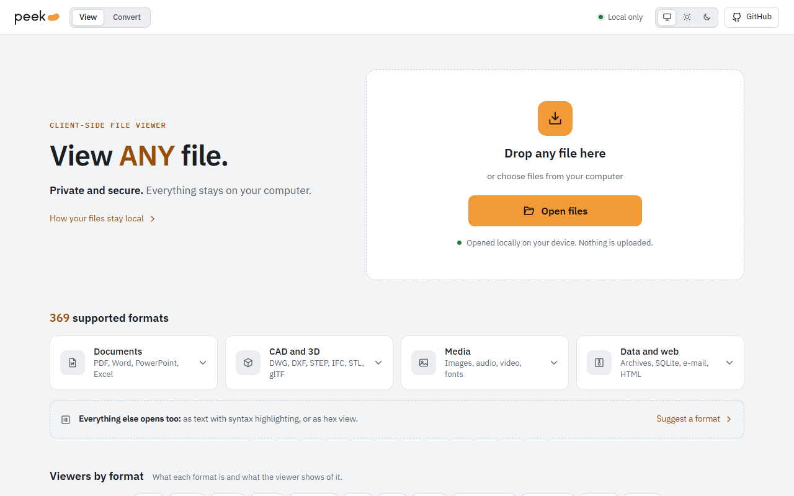
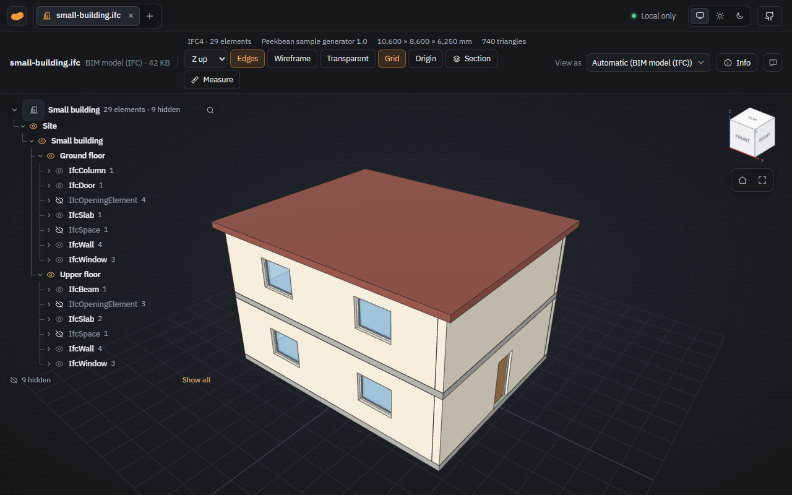
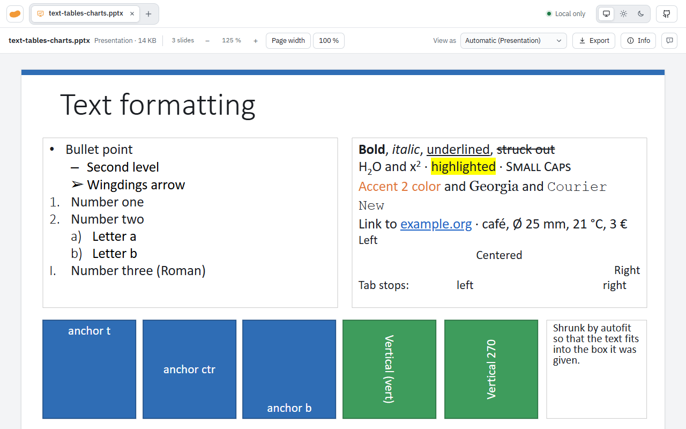
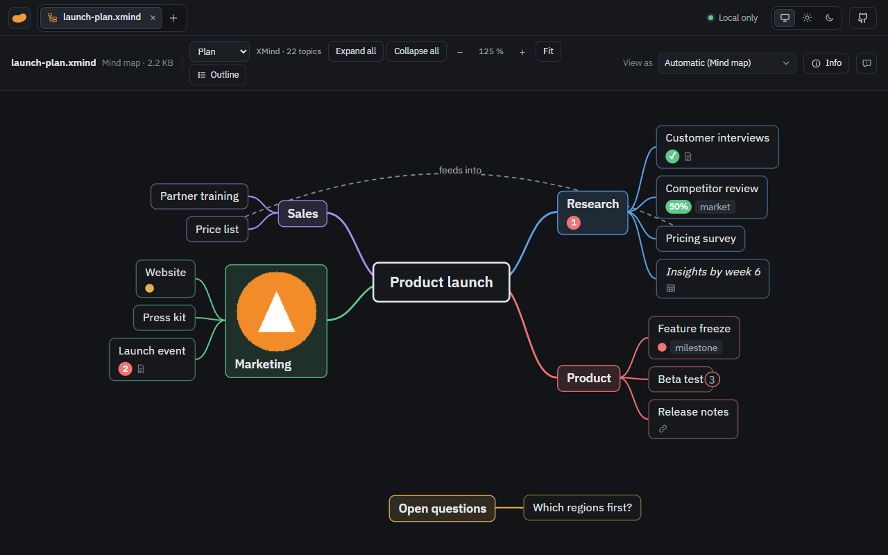
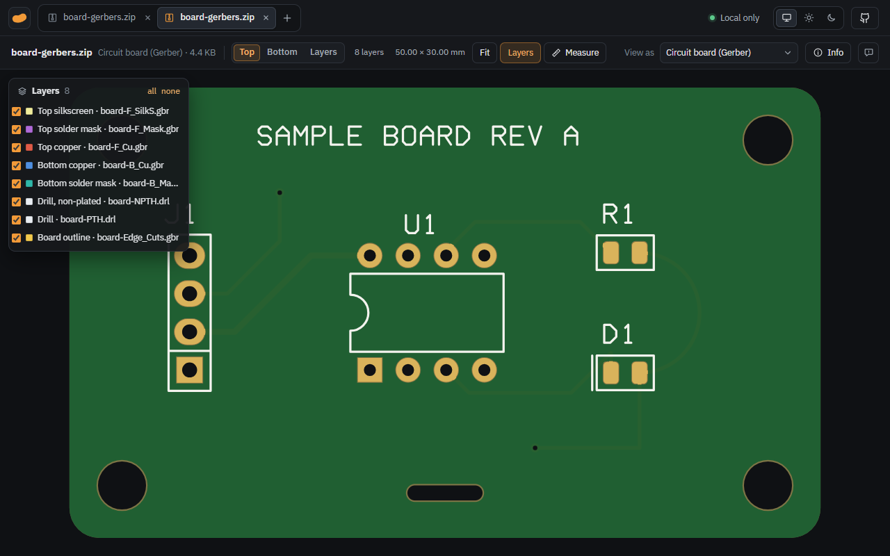
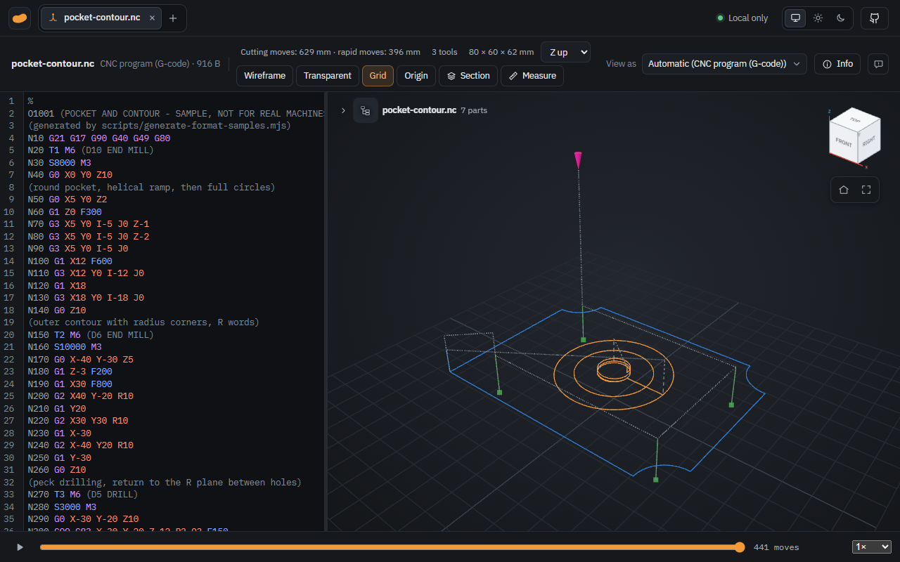
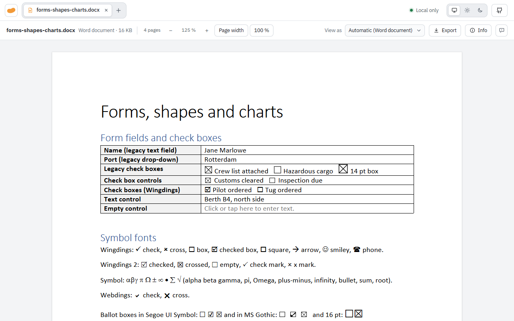

<p align="center">
  <picture>
    <source media="(prefers-color-scheme: dark)" srcset="docs/logo-dark.svg">
    
  </picture>
</p>

<h3 align="center">Open almost any file in your browser, without installing anything and without uploading it anywhere.</h3>

<h2 align="center"><a href="https://peekbean.com">👉 peekbean.com</a></h2>

<p align="center">
  <picture>
    <source media="(prefers-color-scheme: dark)" srcset="docs/screenshots/start-dark.png">
    
  </picture>
</p>

Peekbean is a file viewer and converter that runs entirely in the browser. Drop a file on the page and it opens: a DWG drawing, a STEP model, an IFC building, a Word document, a camera raw photo, an Access database, a Shapefile and more than a hundred other formats. Nothing is uploaded. The site is purely static, and your files never leave your device.

## Why

Someone sends you a file and you just want to look inside. Usually that means installing a program for a format you open twice a year, or uploading the file to some online viewer and trusting a stranger's server with it. Peekbean is the third option: as convenient as a website, as private as a local program.

## Highlights

- **Private by design.** No backend, no accounts, no analytics, no CDNs. A strict Content Security Policy keeps the page from talking to anything but its own origin.
- **One viewer for everything.** Documents, CAD and BIM, 3D, GIS, databases, archives, e-mails, images, all in tabs side by side.
- **More than a preview.** Measure with snapping, inspect metadata, browse IFC properties, query SQLite, play back G-code.
- **Converts locally, too.** Images, PDFs, Office files, audio, spreadsheets, data, 3D models, DWG, maps, databases and more.
- **Nothing to install.** Any modern browser, desktop or phone.
- **Open source.** GPL-3.0-or-later.

## Screenshots

| | |
|---|---|
|  |  |
| **BIM:** IFC model with storeys, elements and properties | **Office:** Word and PowerPoint laid out page by page |
|  |  |
| **Mind maps:** XMind, MindManager, FreeMind | **Circuit boards:** Gerber and drill files as a finished board |
|  |  |
| **CNC:** G-code next to its tool paths, with playback | **Word:** forms, tables, shapes and charts |

## Formats

| | |
|---|---|
| Documents | PDF, Word, PowerPoint, Excel, ODS, Numbers, CSV, RTF, Markdown, Jupyter, EPUB, FB2, HTML |
| CAD and BIM | DWG, DXF, STEP, IGES, BREP, IFC, FreeCAD, Rhino, HPGL plots, Gerber and Excellon, G-code |
| CAD previews | SolidWorks, Inventor, Solid Edge, NX, Creo, CATIA, Blender (embedded preview and properties) |
| 3D and point clouds | STL, OBJ, PLY, glTF/GLB, 3MF, FBX, DAE, 3DS, USD/USDZ, VRML, VTK, LAS/LAZ and more |
| Images | JPG, PNG, WebP, AVIF, HEIC, JPEG XL, TIFF, PSD, SVG, EMF/WMF, EXR, HDR, DDS, camera raw, and previews of Affinity, InDesign, Figma, EPS |
| Data | SQLite, Access, Parquet, Arrow, Shapefile, KML/KMZ, GPX, GeoJSON, TopoJSON |
| Archives | ZIP (also AES), 7Z, RAR, TAR, GZ, BZ2, XZ, ZST, ISO, CAB and more; comics CBZ/CBR/CB7/CBT |
| Other | E-mail (EML, MSG), mind maps (XMind, MindManager, FreeMind), calendars and contacts, fonts, certificates, shortcuts, audio and video, any text or source code, hex for the rest |

**Info** shows metadata such as EXIF and GPS, document properties or CAD part numbers. **Measure** works in 3D, drawings, maps, PDFs and images, with snapping and calibration from a known length. Files inside archives and e-mail attachments open in new tabs.

## Converter

`convert.html` converts many files at once. The viewer's **Export** does the same for the open file. Each conversion says up front what it cannot keep.

| From | To |
|---|---|
| Images | PNG, JPG, WebP, PDF, ICO |
| PDF | PNG, JPG |
| Audio, sound track of videos | WAV |
| Word, PowerPoint | PDF |
| Spreadsheets | XLSX, ODS, CSV, XLS, HTML, JSON, TSV, Markdown |
| JSON, YAML, JSON Lines | JSON, YAML, JSON Lines |
| Subtitles | SRT, VTT |
| 3D models | GLB, STL, OBJ, PLY, USDZ |
| DWG, HPGL | DXF |
| Archives, comics | ZIP, TAR.GZ, CBZ |
| Map data | GeoJSON, KML, GPX, CSV, Shapefile |
| E-mails | EML, HTML, attachments as ZIP |
| Databases | XLSX, CSV, SQLite |

## Privacy

- Files are processed only in the browser. The production build sends a CSP that allows connections only to the site's own origin; serve `dist/_headers` as HTTP headers so it also covers web workers.
- Viewer code loads on demand, so the host's access log can tell *which kind* of file was opened (e.g. "a DWG"), never the file, its name or content.
- HTML pages and e-mails render in a sandboxed iframe without scripts or network access.
- Links to OpenStreetMap (GPS locations) and GitHub (feedback) open only when clicked. Bug report links carry the file type and app version, never the file name.

## Development

```sh
npm install
npm run dev       # development server
npm run build     # type check, production build into dist/, license check
npm run preview   # serve dist/ with the CSP as an HTTP header
npm run samples   # regenerate the sample files in samples/
```

The WebAssembly modules in `src/wasm/` are checked in prebuilt, so building needs neither Rust nor Emscripten. Each viewer is a lazily loaded module in `src/viewers/`, registered in `src/core/registry.ts`. See [CLAUDE.md](CLAUDE.md) for the layout and project rules.

## License

GPL-3.0-or-later, see [LICENSE](LICENSE). The build checks every shipped dependency against an allowlist of GPL-compatible licenses and writes their texts to `dist/third-party-licenses.txt`.

Built on pdf.js, SheetJS, three.js, OpenCascade, web-ifc, dxf-viewer, acadrust, libarchive, CodeMirror and many more, plus [ooxml-pages](https://github.com/Kai-Jungsthoefel/ooxml-pages) for Word and PowerPoint. Design after [SOMA](https://github.com/Kai-Jungsthoefel/SOMA), typeface IBM Plex.
